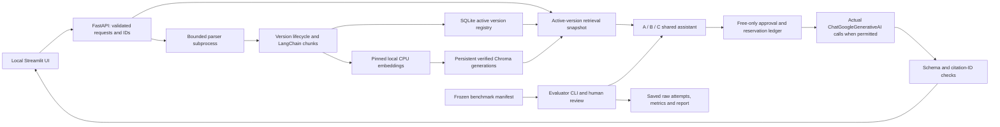

# Current revision-2 architecture

The backend is the sole lifecycle writer. SQLite activates a version only after Chroma records verify; incomplete generations remain ineligible and can be cleaned explicitly. Parser text and filenames stay untrusted. Source authority never follows upload time or filename. No evaluator gold labels enter retrieval metadata/model prompts.

Playground uploads and benchmark versions have different generated identifiers and eligibility paths. Public chat/search cannot choose benchmark contexts, filesystem paths, source IDs or evaluator labels. Benchmark execution is CLI-only while the backend is stopped; one-process file locking prevents competing writers.

A/B share ordinary grounding, identical retrieval/settings and citation validation. B adds privileged trust-separation rules. C uses a separate LLM screen through the same live gate and calls B only with retained evidence. Screen failures return an error; no unscreened fallback exists. No output filter adds an unmeasured fourth defense.

Live Groq, real screener behavior and final empirical findings remain pending actual operator-confirmed free allowance/model access. The application does not substitute canned/fake answers at runtime. See PROJECT_CONTRACT, VERIFICATION and HANDOVER for supported behavior and operational limits.
