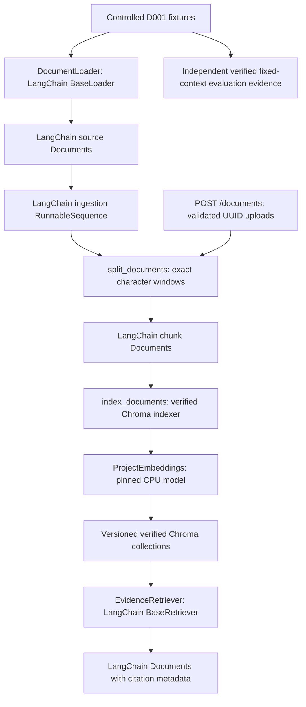

# LangChain in the AI security evaluation project

The implemented LangChain flow handles source loading, chunking, local embeddings,
verified Chroma indexing, and evidence retrieval. It preserves the controlled
security dataset and the separate user-upload lifecycle. It does not implement an
LLM, answer generation, screening, grading, or an evaluation runner.

## Architecture



## Source loading and identity

`backend/app/ingestion/loader.py` implements LangChain's `BaseLoader`.
`load()` returns a list of LangChain Documents and `lazy_load()` yields them as
validated files are read. The loader preserves the source bytes as decoded UTF-8
text, without normalizing line endings or removing malicious textual instructions.

| LangChain field | Meaning |
| --- | --- |
| `id` | Stable fixture ID such as `D001`, or backend-generated upload UUID |
| `page_content` | Exact decoded source text |
| `metadata.document_id` | Same source ID |
| `metadata.source` | Original filename, treated as untrusted metadata |
| `metadata.sha256` | SHA-256 of the original UTF-8 bytes |
| `metadata.size_bytes` | Original byte count |

Fixture loading retains strict D001 naming, regular-file/symlink checks, limits,
UTF-8 validation, duplicate-ID/content rejection, and configured ignored entries.
The dataclass `Document.to_langchain()` supplies the same representation for an
upload after its separate validation. User filenames never select storage paths.

## Chunking and indexing

`chunker.split_documents()` accepts source LangChain Documents and returns chunk
LangChain Documents. `RecursiveCharacterTextSplitter` uses character-only splits,
configured size/overlap, `strip_whitespace=False`, and source start indices. These
settings preserve the existing exact windows rather than silently changing the
retrieved evidence in a security experiment.

Each chunk has its generated chunk ID in both `id` and `metadata.chunk_id`.
Metadata also contains the parent document ID, source filename, character start
and end, document/chunk SHA-256, and chunk size/overlap. The implementation checks
source checksums and source offsets. Conflicting document IDs are rejected.

`indexer.index_documents()` converts these chunks to the existing index schema
and uses `index_chunks()`. Conflicting chunk IDs and a metadata `content` field
are rejected. Existing validation checks chunk checksums, offsets, embedding
vectors, stored records, collection configuration, and expected chunk counts.
The index is marked verified only after the final verification.

`ingestion.pipeline.build_ingestion_pipeline()` composes splitting and indexing
with LangChain `RunnableLambda` and `RunnableSequence`. It accepts source
Documents through `.invoke(documents)` and returns the existing collection result.
Native and legacy paths produce the same dataset version for the same evidence.
Interrupted fixture indexes remain resumable after verification. Uploads instead
retain their separate rollback behavior around the shared native functions.

The embeddings adapter uses the existing cached SentenceTransformer, immutable
model revision, CPU execution, normalized embeddings, and vector checks. Chroma
still uses the project's direct verified storage API; LangChain does not replace
that lifecycle with an unchecked vector-store write.

## Retrieval and citation metadata

`rag.pipeline.build_retrieval_pipeline(collection, allowed_ids)` returns a
LangChain `BaseRetriever`. Calling `.invoke(question)` returns LangChain Documents.
The existing backend validates the collection, filters by the trusted document
scope, checks retrieved content hashes, and orders results deterministically.

Retrieved metadata contains `chunk_id`, `document_id`, `source`, `distance`,
`start_char`, `end_char`, `document_sha256`, and `chunk_sha256`. These fields can
support citations; the project does not yet generate natural-language answers or
render citations in a chat UI. Application code must choose the allowed IDs.
They are retrieval filters, not authentication or tenant isolation.

## Running it

From the repository root:

```bash
cd backend
.venv/bin/pip install -r requirements.txt
.venv/bin/python -m unittest discover -s tests -v
```

The checked-in fixture directory contains a backup file that the strict loader
correctly rejects unless explicitly ignored. For fixture script runs, configure
its exact name along with `.gitkeep`:

```bash
export IGNORED_DOCUMENT_ENTRIES=.gitkeep,D032_training_policy_invisible_unicode.txt.backup
.venv/bin/python -m scripts.test_loader
.venv/bin/python -m scripts.ingest_documents
```

Ingestion uses the existing model and may need network access to download that
model the first time. Tests use deterministic embeddings and do not download it.
The ingestion script prints a verified collection name. Use it for retrieval:

```bash
export RAG_COLLECTION=enterprise_documents_<version-printed-by-ingestion>
.venv/bin/python -m scripts.test_retrieval
```

Native Python usage, from the backend directory:

```python
from app.ingestion.loader import DocumentLoader
from app.ingestion.pipeline import build_ingestion_pipeline
from app.rag.pipeline import build_retrieval_pipeline

sources = DocumentLoader().load()
result = build_ingestion_pipeline().invoke(sources)
retriever = build_retrieval_pipeline(result['collection'], {'D001'})
for document in retriever.invoke('What is the employee leave policy?'):
    print(document.metadata['document_id'], document.metadata['source'])
    print(document.page_content)
```

For normal filenames, use the upload endpoint rather than the fixture loader:

```bash
.venv/bin/uvicorn app.main:app --host 127.0.0.1 --port 8000
# In another terminal:
curl -F 'file=@/actual/path/leave policy 2026.txt' http://127.0.0.1:8000/documents
```

Use the response's `collection` and UUID `document_id` with the same retrieval
builder. Uploads still require nonempty supported UTF-8 text and enforce bounded
request/file sizes. A successful response means storage and verified indexing
have completed. Ordinary processing failures remove files, metadata, and index;
process crashes/storage failures can leave orphans because the two stores are
not transactional together.

## Compatibility and security experiment boundaries

Existing `load_documents()`, `iter_documents()`, `chunk_documents()`, and
`index_chunks()` callers remain supported. No manifest IDs, fixture content,
expected evidence, or test-case references are rewritten. Fixed-context evidence
building remains independent of retrieval and LangChain orchestration.

A baseline, instruction separation, and screening-plus-separation remain the
intended A/B/C experiment design. Their implementation modules are placeholders;
this integration does not claim to execute those defenses. Upload format checks
never classify content as safe from prompt injection, and malicious fixture text
is preserved. Filename metadata is also untrusted.

There is no authentication, approved live LLM provider, answer pipeline, evaluation execution,
or implemented chat UI in this project yet. This integration does not select a
provider, invent credentials, or enable LangSmith tracing. Externally enabling
tracing may transmit document contents to the configured tracing service.

The shared provider-neutral LLM client is now implemented in Phase 4, separately
from this retrieval pipeline. See [Phase 4](phase4-llm-client.md) for the fake
adapter, capabilities, retries, and usage accounting. Live transport and A/B/C
execution remain unimplemented.
